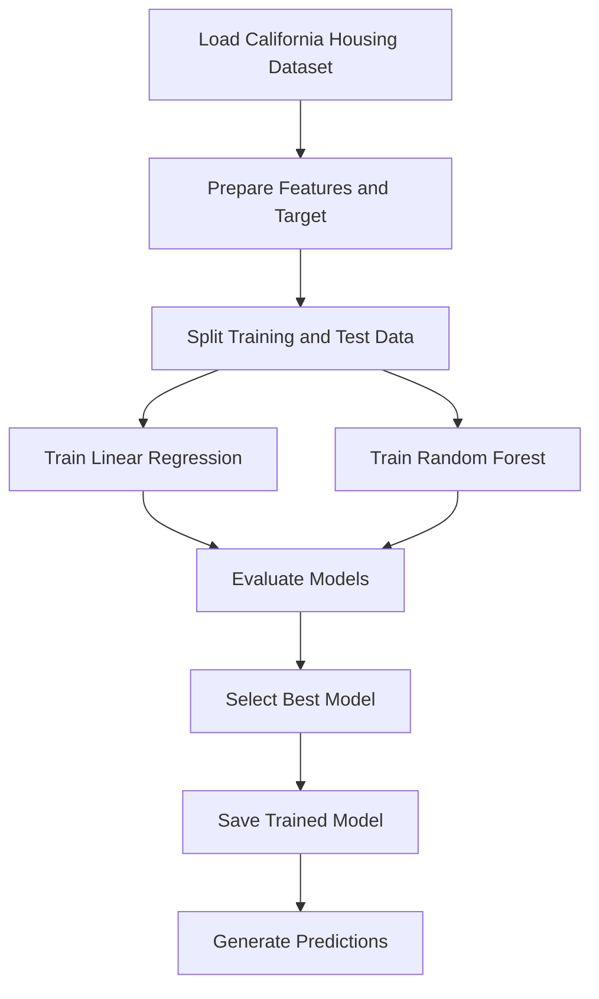

# 🏡 House Price Prediction | Machine Learning with Python

<p align="center">
  <b>Predicting housing values using machine learning, model comparison, and evaluation metrics.</b>
</p>

<p align="center">
  
  
  
  
  
</p>

## 🌟 Project Overview

**House Price Prediction** is a machine learning project that predicts median house values from housing and neighborhood characteristics.

The project uses the **California Housing dataset** and compares two regression algorithms — Linear Regression and Random Forest — to explore how different models learn patterns from data.

The goal is to build a clear, modular, and reproducible machine learning workflow covering model training, evaluation, and prediction.

## 🎯 Project Objectives

- 🏠 Predict median housing values using regression.
- 📊 Explore housing-related numerical features.
- 🤖 Compare multiple machine learning algorithms.
- 📉 Evaluate prediction errors using standard regression metrics.
- 💾 Save the selected trained model for future predictions.
- 🧪 Organize code into reusable modules and test important behavior.

## ✨ Key Features

- 📥 **Dataset Loading:** Load the California Housing dataset using Scikit-learn.
- 🧠 **Model Comparison:** Compare Linear Regression and Random Forest models.
- ⚙️ **Training Pipeline:** Train models using a dedicated Python script.
- 📏 **Model Evaluation:** Calculate MAE, RMSE, and R².
- 🔮 **Prediction Module:** Generate predictions using a saved model.
- 💾 **Model Persistence:** Save the trained model with Joblib.
- 🧪 **Unit Tests:** Include tests for training and prediction functionality.
- 🧩 **Modular Architecture:** Keep training, evaluation, and prediction logic separate.

## 🛠️ Tech Stack

| Technology | Purpose |
|---|---|
| 🐍 Python | Core programming language |
| 🧮 NumPy | Numerical operations |
| 🐼 Pandas | Data handling and analysis |
| 🤖 Scikit-learn | Dataset loading and machine learning |
| 🌲 Random Forest | Nonlinear regression model |
| 📈 Linear Regression | Baseline regression model |
| 💾 Joblib | Saving and loading trained models |
| 🧪 Pytest | Automated testing |

## 📊 Dataset

This project uses the California Housing dataset provided by Scikit-learn. It contains **20,640 observations and 8 input features**. The target represents median house value for California districts, expressed in units of $100,000. [Dataset documentation](https://scikit-learn.org/stable/modules/generated/sklearn.datasets.fetch_california_housing.html).

### 🏘️ Input Features

| Feature | Description |
|---|---|
| `MedInc` | Median income in the district |
| `HouseAge` | Median house age |
| `AveRooms` | Average number of rooms per household |
| `AveBedrms` | Average number of bedrooms per household |
| `Population` | District population |
| `AveOccup` | Average household occupancy |
| `Latitude` | Geographic latitude |
| `Longitude` | Geographic longitude |

🎯 **Target variable:** `MedHouseVal` — median house value.

> 💡 Note: This is a California district-level housing dataset, not a dataset of individual Indian property listings. Predictions are estimates based on patterns in this dataset.

## ⚙️ Machine Learning Workflow



### 🔍 Workflow Breakdown

1. **Data loading:** Retrieve the housing dataset.
2. **Feature preparation:** Separate the input variables from the target.
3. **Data splitting:** Separate training data from unseen test data.
4. **Model training:** Fit Linear Regression and Random Forest models.
5. **Model evaluation:** Compare model performance using regression metrics.
6. **Model selection:** Choose a model based on the evaluation results.
7. **Model persistence:** Save the selected model for reuse.
8. **Prediction:** Load the saved model and predict values for new inputs.

## 📏 Evaluation Metrics

The project uses three standard regression metrics:

| Metric | What It Tells Us |
|---|---|
| **MAE** — Mean Absolute Error | Average absolute difference between predictions and actual values |
| **RMSE** — Root Mean Squared Error | Penalizes larger prediction errors more strongly |
| **R² Score** | Measures how well the model explains variation in the target |

📌 Lower MAE and RMSE generally indicate better predictions. An R² score closer to 1 generally indicates a stronger fit, though evaluation should also consider the test data and the dataset's limitations.

## 📂 Project Structure

```text
housing-price-prediction/
│
├── src/
│   ├── train.py           # Train and compare regression models
│   ├── predict.py         # Generate predictions using saved model
│   └── evaluate.py        # Regression evaluation metrics
│
├── tests/
│   ├── test_train.py      # Training-related tests
│   └── test_predict.py    # Prediction-related tests
│
├── models/
│   └── .gitkeep           # Keeps the models directory in Git
│
├── .gitignore             # Excludes generated and sensitive files
├── requirements.txt       # Project dependencies
└── README.md              # Project documentation
```

## 🚀 Getting Started

### 1️⃣ Clone the Repository

```bash
git clone https://github.com/kanishak2004/housing-price-prediction.git
cd housing-price-prediction
```

### 2️⃣ Create a Virtual Environment

```bash
python -m venv .venv
```

Activate the environment:

**macOS / Linux**
```bash
source .venv/bin/activate
```

**Windows**
```bash
.venv\Scripts\activate
```

### 3️⃣ Install Dependencies

```bash
pip install -r requirements.txt
```

### 4️⃣ Train the Models

```bash
python -m src.train
```

This runs the training script. Depending on the implementation, it may download the dataset, train the models, evaluate their performance, and save the selected model.

### 5️⃣ Generate Predictions

```bash
python -m src.predict
```

Run this after training has successfully created the model file expected by the prediction script.

### 6️⃣ Run Tests

```bash
pytest -q
```

Use the test results to verify the implemented training and prediction behavior.

## 📸 Results and Screenshots

Add genuine outputs from your training and evaluation scripts here once you have run the project.

Suggested screenshots:

- 📊 Model comparison and evaluation metrics.
- 📉 MAE, RMSE, and R² results.
- 🔮 Example prediction output.
- 🧪 Successful test results.

<!-- Add actual screenshots or console output images here after running the project. -->

## 🔮 Future Improvements

- 📊 Add exploratory data analysis and feature visualizations.
- 🎛️ Perform hyperparameter tuning with cross-validation.
- 📈 Compare additional regression algorithms.
- 🌐 Build an interactive Streamlit prediction interface.
- 🐳 Containerize the project using Docker.
- 🔄 Add continuous integration with GitHub Actions.
- 📦 Track experiments and compare model versions.
- 🚀 Deploy the trained model through an API.

## 💡 What I Learned

Through this project, I aim to demonstrate practical understanding of:

- Supervised machine learning and regression.
- Feature-target separation and train-test splitting.
- Comparing baseline and ensemble models.
- Evaluating models with regression metrics.
- Saving and reusing trained machine learning models.
- Writing modular, testable Python code.
- Structuring a machine learning project for GitHub.

## 👨‍💻 Author

**Kanishak Thakur**

💼 Aspiring AI/ML Engineer | Software Developer

🔗 [GitHub Profile](https://github.com/kanishak2004)

📂 [View House Price Prediction Repository](https://github.com/kanishak2004/housing-price-prediction)

---

<p align="center">
  ⭐ If you find this project interesting, consider starring the repository!
</p>

<p align="center">
  <i>Turning housing data into data-driven predictions. 🏡📊</i>
</p>
